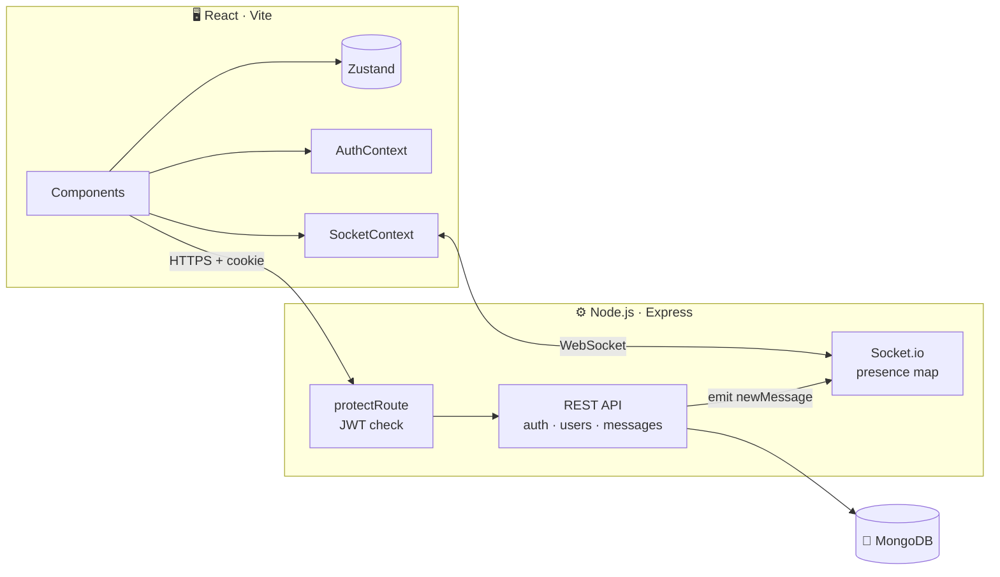
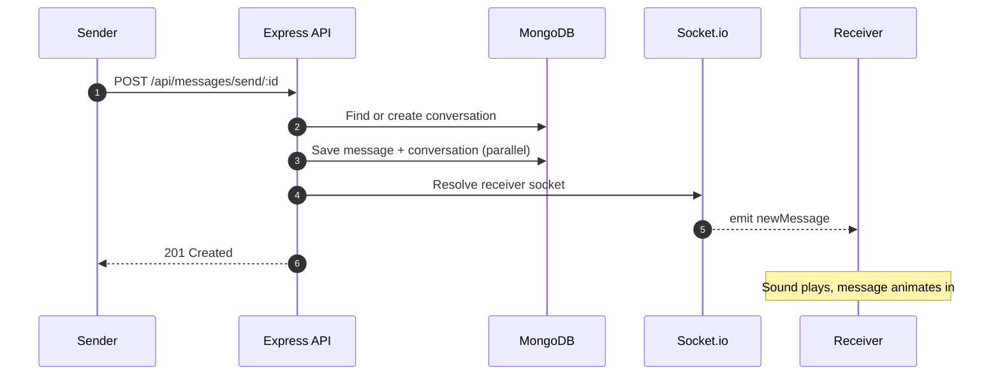

<div align="center">


<p>
  
  
  
  
  
  
  
</p>

<p>
  <b>
    <a href="#-overview">Overview</a> ·
    <a href="#-engineering-highlights">Highlights</a> ·
    <a href="#-architecture">Architecture</a> ·
    <a href="#-getting-started">Getting Started</a> ·
    <a href="#-api-reference">API</a> ·
    <a href="#-deployment">Deployment</a>
  </b>
</p>

<br />


</div>

<br />

## 📌 Overview

**MERN Chat** is a full-stack, real-time messaging application. Users sign up, see who is online, and exchange one-to-one messages that arrive instantly over WebSockets and persist in MongoDB.

The project is built as a production-shaped system rather than a demo: stateless cookie-based authentication, protected REST routes, a socket layer for presence and targeted delivery, and a single deployable Node service that serves both the API and the compiled React client.

<br />

## ✨ Features

<table>
  <tr>
    <td width="50%" valign="top">
      <h3>🔐 Secure Authentication</h3>
      bcrypt-hashed passwords and a signed JWT stored in an <code>httpOnly</code>, <code>sameSite=strict</code> cookie with a 15-day lifetime.
    </td>
    <td width="50%" valign="top">
      <h3>⚡ Instant Delivery</h3>
      Each message is persisted and pushed to the recipient's socket in the same request cycle.
    </td>
  </tr>
  <tr>
    <td valign="top">
      <h3>🟢 Live Presence</h3>
      Online status is broadcast to every connected client the moment a user joins or leaves.
    </td>
    <td valign="top">
      <h3>🔔 Smart Alerts</h3>
      Incoming messages trigger a notification sound and a shake animation in the active chat.
    </td>
  </tr>
  <tr>
    <td valign="top">
      <h3>🔎 People Search</h3>
      Find any user by name from the sidebar and jump straight into the conversation.
    </td>
    <td valign="top">
      <h3>🎨 Polished Interface</h3>
      Dark glassmorphism UI with generated avatars, skeleton loaders and toast feedback.
    </td>
  </tr>
</table>

<br />

## 🧠 Engineering Highlights

| Decision | Why it matters |
|:---|:---|
| **JWT in an `httpOnly` cookie** | The token is never readable by JavaScript, closing off token theft through XSS. `sameSite=strict` blocks cross-site request forgery, and `secure` is enforced outside development. |
| **Route-level auth middleware** | A single `protectRoute` layer verifies the token, loads the user without the password hash, and attaches it to the request. Controllers stay free of auth logic. |
| **Parallel writes** | The message and its conversation are saved together with `Promise.all`, cutting a round trip from every send. |
| **Lazy conversation creation** | A conversation document is created only on the first message between two users, so empty threads never hit the database. |
| **Targeted socket delivery** | The server keeps a `userId → socketId` map and emits only to the recipient, rather than broadcasting every message. |
| **Constant-time login failure** | Login always runs a bcrypt comparison and returns one generic error, so responses do not reveal which usernames exist. |
| **Single deployable unit** | Express serves the built React app and the API from one origin, removing CORS and cross-domain cookie issues in production. |

<br />

## 🏗 Architecture



<details>
<summary><b>Message lifecycle</b></summary>
<br />



</details>

<br />

## 🧰 Tech Stack

| Layer | Technologies |
|:---|:---|
| **Frontend** | React 18, Vite, React Router, Zustand, Socket.io Client, TailwindCSS, DaisyUI, React Hot Toast, React Icons |
| **Backend** | Node.js, Express, Socket.io, Mongoose, JSON Web Token, bcryptjs, cookie-parser |
| **Database** | MongoDB |
| **Tooling** | Nodemon, ESLint, PostCSS, Autoprefixer |

<br />

## 🚀 Getting Started

### Prerequisites

- Node.js 18 or later
- A MongoDB instance, local or [MongoDB Atlas](https://www.mongodb.com/atlas)

### Installation

```bash
git clone https://github.com/differentiatorX/mern-chat.git
cd mern-chat

npm install
npm install --prefix frontend
```

### Configuration

Create a `.env` file in the project root:

```env
PORT=5000
MONGO_DB_URI=mongodb+srv://<user>:<password>@<cluster>/chat-app
JWT_SECRET=replace_with_a_long_random_string
NODE_ENV=development
```

| Variable | Required | Description |
|:---|:---:|:---|
| `PORT` | | Server port, defaults to `5000` |
| `MONGO_DB_URI` | ✅ | MongoDB connection string |
| `JWT_SECRET` | ✅ | Secret used to sign auth tokens |
| `NODE_ENV` | ✅ | Use `development` locally. Any other value marks the cookie `secure`, which requires HTTPS |

### Run locally

```bash
# Terminal 1 · API and sockets on :5000
npm run server

# Terminal 2 · React app on :3000
npm run dev --prefix frontend
```

Open **http://localhost:3000**, create two accounts in separate browsers, and start chatting.

<details>
<summary><b>All available scripts</b></summary>
<br />

| Command | Location | Description |
|:---|:---|:---|
| `npm run server` | root | Backend with hot reload |
| `npm start` | root | Backend in production mode |
| `npm run build` | root | Installs all dependencies and builds the client to `frontend/dist` |
| `npm run dev` | frontend | Vite dev server, proxies `/api` to port 5000 |
| `npm run lint` | frontend | ESLint check |

</details>

<br />

## 📡 API Reference

Routes under `/api/users` and `/api/messages` require the `jwt` cookie issued at login or signup.

<details open>
<summary><b>Authentication</b></summary>
<br />

| Method | Endpoint | Body | Response |
|:---:|:---|:---|:---|
| `POST` | `/api/auth/signup` | `fullName` `username` `password` `confirmPassword` `gender` | `201` user, sets cookie |
| `POST` | `/api/auth/login` | `username` `password` | `200` user, sets cookie |
| `POST` | `/api/auth/logout` | | `200`, clears cookie |

</details>

<details open>
<summary><b>Users & Messages</b></summary>
<br />

| Method | Endpoint | Body | Response |
|:---:|:---|:---|:---|
| `GET` | `/api/users` | | All users except the caller |
| `GET` | `/api/messages/:id` | | Message history with user `:id` |
| `POST` | `/api/messages/send/:id` | `message` | `201` saved message |

</details>

<details>
<summary><b>Socket events</b></summary>
<br />

| Event | Direction | Payload |
|:---|:---|:---|
| `getOnlineUsers` | Server → all clients | Array of online user IDs |
| `newMessage` | Server → recipient | Saved message document |

</details>

<details>
<summary><b>Data models</b></summary>
<br />

```js
User          { fullName, username (unique), password (hashed), gender, profilePic, timestamps }
Message       { senderId → User, receiverId → User, message, timestamps }
Conversation  { participants: [User], messages: [Message], timestamps }
```

</details>

<br />

## 📁 Project Structure

```
mern-chat/
├── backend/
│   ├── controllers/     Request handlers for auth, messages, users
│   ├── db/              MongoDB connection
│   ├── middleware/      protectRoute JWT guard
│   ├── models/          User, Message, Conversation schemas
│   ├── routes/          Express routers
│   ├── socket/          Socket.io server and presence map
│   ├── utils/           Token and cookie helper
│   └── server.js        Entry point, serves the built client
│
├── frontend/src/
│   ├── components/      Messages, sidebar, skeleton loaders
│   ├── context/         AuthContext, SocketContext
│   ├── hooks/           Data and socket hooks
│   ├── pages/           Home, Login, SignUp
│   └── zustand/         Conversation store
│
└── package.json         Backend dependencies and root scripts
```

<br />

## ☁️ Deployment

The app runs as one Node service, so it deploys to Render, Railway, Fly.io or any VPS without extra configuration.

| Setting | Value |
|:---|:---|
| **Build command** | `npm run build` |
| **Start command** | `npm start` |
| **Environment** | `MONGO_DB_URI`, `JWT_SECRET`, `NODE_ENV=production` |

To host the client on a separate domain, add its URL to `cors.origin` in `backend/socket/socket.js`.

<br />

## 🗺 Roadmap

- [x] Authentication with secure cookies
- [x] Real-time one-to-one messaging
- [x] Online presence
- [ ] Typing indicators
- [ ] Read receipts and unread counts
- [ ] Image and file attachments
- [ ] Group conversations
- [ ] Paginated message history
- [ ] Redis adapter for horizontal scaling

<br />

## 🤝 Contributing

Contributions are welcome.

1. Fork the repository
2. Create a branch: `git checkout -b feat/your-feature`
3. Commit using [Conventional Commits](https://www.conventionalcommits.org): `git commit -m "feat: add typing indicator"`
4. Push and open a pull request

<br />

## 📄 License

Distributed under the MIT License. See [`LICENSE`](LICENSE) for details.

<br />

<div align="center">

**Built by [differentiatorX](https://github.com/differentiatorX)**

If you found this project useful, consider giving it a ⭐


</div>
